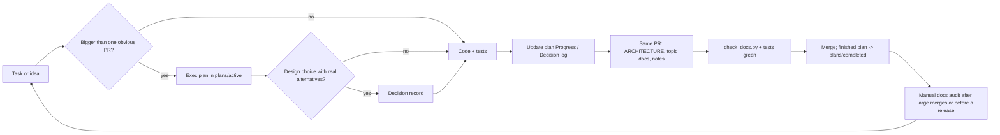

# Docs workflow

How a task moves through the docs, who updates what, and which checks enforce it. Agents follow this; humans steer by editing plans, decisions, and `AGENTS.md`.

## The loop



## Steps

1. **Size the task.** One PR with obvious edits needs no plan. Work that spans PRs, sessions, or agents, or that a fresh agent must be able to resume, gets an exec plan: copy `plans/active/_template.md` to `plans/active/<yyyy-mm-dd>-<slug>.md`. Done when the plan's Purpose and Validation sections let a stranger tell success from failure.
2. **Record real choices.** When the plan picks between alternatives that someone may later re-propose, write a decision in `decisions/` and link it from the plan. A choice nobody would question stays a one-line entry in the plan's Decision log.
3. **Code with the plan open.** At every stopping point, update Progress (done vs remaining, with timestamps), Surprises & Discoveries (with evidence), and Decision log. Done when another agent could resume from the plan alone.
4. **Docs in the same PR.** If the change moves a module, boundary, or invariant, edit `ARCHITECTURE.md`. If it changes user-visible behaviour, edit the topic doc. If something cost real time to figure out, add a note, and prefer turning it into a test or lint.
5. **Close the plan.** Write Outcomes & Retrospective, move the file to `plans/completed/`, and add any leftover debt to `quality.md`.
6. **Audit by hand when it pays.** After a large merge or before a release, run the audit in the `agent-docs-workflow` skill: stale plans, docs that contradict code, process leakage, notes ready to become lints, debt to pay down. Fix what it finds in small PRs.

## Who updates what

| Doc | Written by | Updated when | Reviewed by |
|---|---|---|---|
| `AGENTS.md` | Human intent, agent wording | A repeated mistake needs a standing order, or a pointer changes | Human |
| `ARCHITECTURE.md` | Agent doing the change | Module, boundary, or invariant changes | PR reviewer (agent or human) |
| `plans/active/*` | Agent executing the plan | Every stopping point | Human skims Progress |
| `decisions/*` | Agent proposing, human accepting | A choice with real alternatives; superseded by a new record, never rewritten into a different decision | Human for status `accepted` |
| `notes/*` | Agent that hit the problem | Right after it is solved | Docs audit |
| `quality.md` | Agent doing the change or the audit | When a plan leaves debt, a debt is paid, or an audit finds a stale grade | Human skims |

## Mechanical checks

`python3 scripts/check_docs.py` runs in CI and locally. Zero config: rules and budgets are constants at the top of the script. It fails on:

- broken relative links and missing `#anchors` in Markdown;
- backticked repo paths in `AGENTS.md` and `ARCHITECTURE.md` that no longer exist (the stale-doc lint);
- size budgets: `AGENTS.md` over 100 lines, `ARCHITECTURE.md` over 400, any other doc over 500;
- unfilled template guidance (`<!-- guide:` comments) outside `_template.md` files;
- top-level `docs/*.md` files not linked from `docs/README.md`;
- exec plans missing a required section;
- decisions with a missing or illegal `Status:` value, a `superseded by` link that does not resolve, no `Alternatives considered` section, or (when accepted) a `## Plan` or `## Acceptance criteria` section;
- a skill in `.agents/skills/<name>` without the symlink `.claude/skills/<name>` -> `../../.agents/skills/<name>`, or an entry in `.claude/skills/` with no matching skill.

It warns (does not fail) on active plans untouched in git for 14 days: finish, update, or move them.

When a check fails, its message says how to fix it. When a rule keeps getting broken by hand, add it to this script or to the project's linters instead of adding prose.

CI step (GitHub Actions; python3 is on the default runners):

```yaml
- uses: actions/checkout@v4
  with: { fetch-depth: 0 }   # history lets the plan-staleness warning read git dates
- run: python3 scripts/check_docs.py
```
